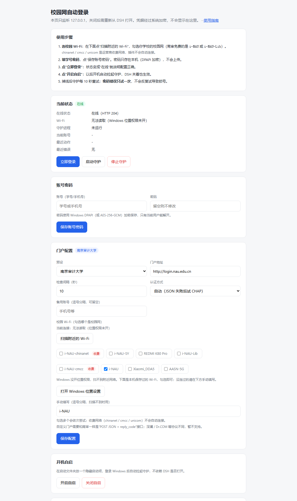
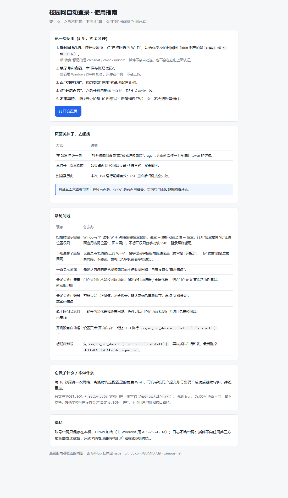

# dsh-campus-net

Campus network auto-login for **DeepSeek Harness (DSH)**. Check whether you are online, log in on demand, and optionally run a small background daemon that reconnects after sleep, reboot, or a portal timeout — even when DSH is closed.

Ships a preset for **Nanjing Audit University (南京审计大学)** and a configurable JSON-portal mode for similar portals.



## Features

- **Status at a glance** — online/offline, Wi-Fi SSID, daemon state, last action and last error.
- **On-demand login** — one tool call, using credentials encrypted on disk.
- **Local settings page** — scan and pick campus Wi-Fi, account/password, portal address, check interval, autostart. Bound to `127.0.0.1` with a per-run token.
- **First-run guide** — on first load the plugin opens the user guide (five steps, how to find the page again, troubleshooting). It only opens once (`autoOpenGuide: false` disables it). DSH has no install-time popup hook, so this is the closest thing.
- **Optional background daemon** — a separate Node process, not a child of DSH, so it keeps running after DSH exits. `install` also registers a hidden Startup entry so it comes back after reboot.
- **No account lockout** — a wrong password is never retried; it stops and reports the portal message.

## Requirements

- DSH `>= 0.2.0-rc.1 < 0.3.0`
- Node.js 20+ (DSH bundles one)
- **Windows 10/11** for the full feature set (DPAPI credentials, `netsh` Wi-Fi switching, Startup autostart). On macOS/Linux the portal login and daemon work, but automatic Wi-Fi switching is skipped and autostart must be configured manually.

## Install

From the DSH plugin market: search for **dsh-campus-net** and install.

Manual (from a checkout):

```bash
dsh plugin add link:/absolute/path/to/dsh-campus-net
```

Restart DSH if the four tools do not appear immediately.

## Guide

The plugin opens this guide on first load. You can also run `campus_net_setup` and click **User guide** at the top of the settings page.



## Setup

1. Ask DSH to run `campus_net_setup`. It returns a `http://127.0.0.1:<port>/?token=…` URL.
2. In **Campus Wi-Fi**, press **Scan nearby Wi-Fi** and tick your campus network (at NAU the free ones are `i-NAU` and `i-NAU-Lib`; `chinanet` / `cmcc` / `unicom` are paid carrier networks and are never auto-connected).
3. Fill in your campus account and password, then **Save**.
4. Press **Login now** to verify.
5. Press **Enable autostart** (or run `campus_net_daemon { "action": "install" }`) if you want it to survive reboot.

> Scanning needs Windows location permission: Settings → Privacy & security → Location, enable location services and desktop app access. You can also type the SSID manually; login still works without the permission.

> With a global proxy or game accelerator running, the portal sees a non-campus source address and login fails with `请重新获取地址!` (please obtain the address again). Quit those tools, or add a direct route to the portal IP, before logging in.

The settings link is valid only while the plugin process is alive. Re-run `campus_net_setup` after restarting DSH.

### Nanjing Audit University

The `nau` preset is pre-filled:

| Field | Value |
| --- | --- |
| Portal | `http://login.nau.edu.cn` |
| Login API | `/api/portal/v1/login` |
| Success | `reply_code === 0` |
| Wi-Fi | `i-NAU` (fallback: `i-NAU-Lib`). Carrier networks chinanet / cmcc / unicom are paid and never auto-joined |
| Online probe | `http://connect.rom.miui.com/generate_204` → HTTP 204 |

Your account is your student ID. The phone number is **not** accepted by this portal.

### Other portals

Choose **Custom JSON portal** if your portal behaves like the NAU one: JSON over HTTP, a `reply_code` field, and the four endpoints `getinfo` / `login` / `logout` / `challenge`. Adjust the portal URL in the settings page.

This plugin does **not** implement Srun (深澜) or Dr.COM protocols. Please do not list it as supporting them.

## Tools

| Tool | What it does |
| --- | --- |
| `campus_net_status` | Online state, SSID, daemon state, last error. `quick: true` reads cached state only. |
| `campus_net_login` | Logs in now; tries the configured Wi-Fi first. |
| `campus_net_setup` | Starts the local settings page and returns its tokenized URL. |
| `campus_net_daemon` | `status` / `start` / `stop` / `install` / `uninstall` / `logs`. |

## How it works

- **Online check**: only HTTP **204** from the probe URL counts as online. Many campus gateways answer any request with `200` plus a login page, so `200` is deliberately treated as offline.
- **Wi-Fi**: `netsh wlan connect` to the configured SSIDs in order, then re-check the interface.
- **Portal**: POST JSON to the login path. If the JSON login fails and `auth` is `auto`, it retries once with CHAP (`md5(ident_byte + password + challenge_hex)`).
- **Accounts**: the saved username, then any aliases in `usernames`. It only tries the next account when the portal says the account does not exist (`E012`/`E027` or `io_reply_code` 12/27). A wrong password stops immediately.
- **Already online elsewhere** (`E013`/`E002`/`E028`): logs out the current session and retries once.
- **Daemon**: a single Node process listens on `127.0.0.1:47215` as its single-instance lock. On Windows it is launched through WMI `Win32_Process.Create` so it is not tied to DSH's job object. A `stop.flag` file makes it exit within ~2 seconds.

## Data and privacy

Everything stays on your machine. There is no telemetry and no third-party service.

| Path | Contents |
| --- | --- |
| `%LOCALAPPDATA%\dsh-campus-net\config.json` | Portal, SSIDs, interval, usernames |
| `%LOCALAPPDATA%\dsh-campus-net\cred.dat` | Encrypted username + password |
| `%LOCALAPPDATA%\dsh-campus-net\campus-net.log` | Append-only log (rotated at 512 KB) |
| `%LOCALAPPDATA%\dsh-campus-net\state.json` | Last check/login result, current account, PID |

On Windows the credentials are encrypted with **DPAPI (CurrentUser)**. On other platforms they use **AES-256-GCM** with a `0600` key file. The password is never written to logs, tool output, or the settings page. It is passed to PowerShell through an environment variable for the DPAPI call, so it does not appear on a command line.

Set `DSH_CAMPUS_NET_HOME` to use a different data directory.

## Uninstall

1. `campus_net_daemon { "action": "uninstall" }` — removes autostart and stops the daemon.
2. Remove the plugin in DSH.
3. Optionally delete `%LOCALAPPDATA%\dsh-campus-net`.

## Troubleshooting

- **“没有保存账号密码”** — open `campus_net_setup` and save the account first.
- **Password error** — the plugin will not retry. Fix the password in the settings page; repeated failures can lock some portals.
- **Portal changed** — update the portal URL/paths via the custom JSON mode, or open an issue.
- **Daemon not running after reboot** — Windows only; check that autostart is enabled and that the Startup entry `dsh-campus-net.vbs` exists.
- **Port 47215 already in use** — another copy is running, or change `lockPort` in `config.json`.
- **DSH closed and network dropped** — install the daemon; the plugin itself only runs while DSH is open.

## Development

```bash
node test/smoke.mjs
```

The smoke test uses a temporary data directory and covers config normalization, tool shapes, DPAPI round-trip, and the settings server (including token rejection).

## License

MIT
