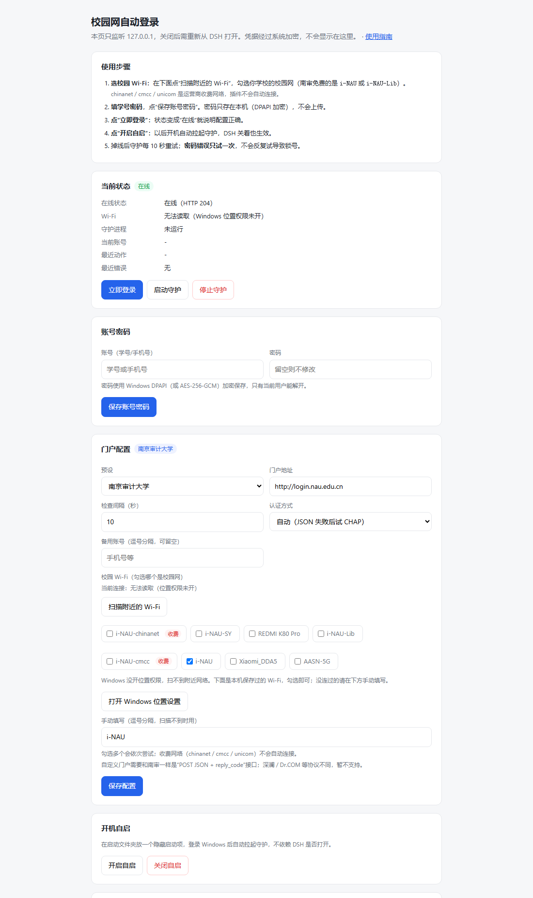
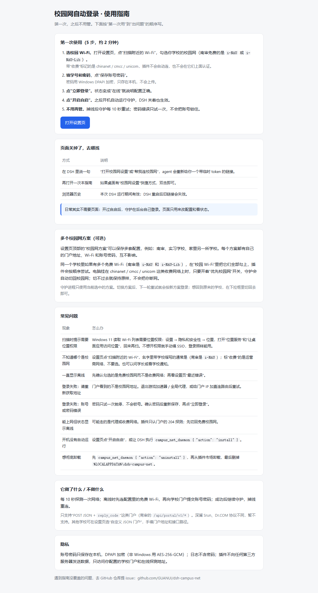

# dsh-campus-net

给 **DeepSeek Harness（DSH）** 用的校园网自动登录插件。可以查看当前是否在线、手动登录，也可以装一个常驻后台的守护进程，在睡眠、重启或门户掉线后自动重连——DSH 关掉也照常工作。

内置**南京审计大学**预设，另外提供可配置的 JSON 门户模式。



## 功能

- **状态一眼看清**：是否在线、连的哪个 Wi-Fi、守护是否在跑、最近一次动作和错误。
- **随时登录**：一条工具调用即可，账号密码加密保存在本机。
- **本地设置页**：扫描并勾选校园 Wi-Fi、填账号密码、改门户、检查间隔、开机自启；只监听 `127.0.0.1`，每次启动带临时 token。
- **多个校园网方案**：同时保存本校、实习校区等几套配置，各自独立的门户、Wi-Fi 和账号密码，守护只用当前选中的那套。
- **优先校园网**：电脑挂在 chinanet / cmcc / unicom 这类收费网络上时，只有扫描确认配置的免费校园网就在附近，守护才会切回去；看不到就保持原网络，不会把你断网。守护启动时还会把保存过的 `cmcc` / `unicom` 改成“手动连接”，避免 Windows 在校园网连不上时自动落到它们上面。不需要可在设置页取消“优先校园网”。
- **首次自动弹指引**：插件第一次加载时自动打开**使用指南**页（五步上手、找不到页面怎么办、常见问题）；只弹一次（配置里 `autoOpenGuide: false` 可关）。DSH 宿主没有“安装完成弹窗”的钩子，这是最接近的一步。
- **可选的后台守护**：独立 Node 进程，不是 DSH 的子进程，DSH 退出后继续跑；`install` 还会在启动文件夹放一个隐藏启动项，重启后自动回来。
- **不会试锁账号**：密码错误只报错、不重试；只有门户明确说“账号不存在”才换下一个账号。

## 环境要求

- DSH `>= 0.2.0-rc.1 < 0.3.0`
- Node.js 20+（DSH 自带）
- **Windows 10/11** 功能最完整（DPAPI 加密、`netsh` 切 Wi-Fi、启动项自启）。macOS / Linux 上登录和守护可用，但不会自动切 Wi-Fi，自启需要自行配置。

## 安装

在 DSH 插件市场里搜索 **dsh-campus-net** 安装。

手动安装（从本地目录）：

```bash
dsh plugin add link:/绝对路径/dsh-campus-net
```

如果四个工具没有立刻出现，重启 DSH。

## 使用指南

插件第一次加载会自动打开这份指南；也可以让 DSH 执行 `campus_net_setup`，在设置页顶部点“使用指南”。



## 配置

1. 让 DSH 执行 `campus_net_setup`，会返回一个 `http://127.0.0.1:<端口>/?token=…` 链接。
2. 打开后在“校园 Wi-Fi”里点“扫描附近的 Wi-Fi”，勾选你学校的校园网（南审免费的是 `i-NAU` / `i-NAU-Lib`；`chinanet` / `cmcc` / `unicom` 是收费网络，插件不会自动连接）。
3. 填校园网账号和密码，点“保存账号密码”。
4. 点“立即登录”验证。
5. 想让它重启后也生效，点“开启自启”，或执行 `campus_net_daemon { "action": "install" }`。

> 扫描不到网络，多半是 Windows 没开位置权限：设置 → 隐私和安全性 → 位置，打开“位置服务”和“让桌面应用访问位置”。不想开权限也可以手动填 SSID，登录不受影响。

> 开着全局代理 / 游戏加速器时，门户看到的来源地址不是校园网 IP，登录会报 `请重新获取地址!`。先退出这类软件（或给门户 IP 加一条直连路由），再登录。

设置页只在插件进程活着时有效；重启 DSH 后重新执行 `campus_net_setup` 即可。

### 多个校园网方案

设置页顶部的“校园网方案”可以同时保存多套配置，比如本校和偶尔去的另一个校区。每个方案有独立的门户、Wi-Fi、账号和密码；用下拉框切换，点“新建”复制当前方案，点“重命名”/“删除”管理。守护进程只用当前选中的方案，切换后下一轮重试生效。

### 南京审计大学

`nau` 预设已经填好：

| 项目 | 值 |
| --- | --- |
| 门户 | `http://login.nau.edu.cn` |
| 登录接口 | `/api/portal/v1/login` |
| 成功标志 | `reply_code === 0` |
| Wi-Fi | 设置页扫描后勾选；南审免费的是 `i-NAU` / `i-NAU-Lib`（都免费，按顺序尝试）；运营商网络 chinanet / cmcc / unicom 收费，不自动连接 |
| 在线探测 | `http://connect.rom.miui.com/generate_204` 返回 HTTP 204 |

账号是学号；这个门户不接受手机号。

### 其他学校

如果你们学校也是“JSON + `reply_code`”这一套（四个接口 `getinfo` / `login` / `logout` / `challenge`），可以在设置页选“自定义 JSON 门户”，改门户地址即可。

本插件**没有**实现深澜（Srun）或 Dr.COM 协议，请不要把它们写成已支持。

## 工具

| 工具 | 作用 |
| --- | --- |
| `campus_net_status` | 在线状态、SSID、守护状态、最近错误；`quick: true` 只读缓存。 |
| `campus_net_login` | 立刻登录，会先尝试连上配置的 Wi-Fi。 |
| `campus_net_setup` | 启动本地设置页，返回带 token 的链接。 |
| `campus_net_daemon` | `status` / `start` / `stop` / `install` / `uninstall` / `logs`。 |

## 工作原理

- **在线判断**：只有探测地址返回 **HTTP 204** 才算在线。很多校园网关对任何请求都回 `200` + 登录页，所以 `200` 一律按离线处理。
- **Wi-Fi**：依次 `netsh wlan connect` 配置里的 SSID，再复查接口状态。
- **门户**：POST JSON 到登录接口；`auth` 为 `auto` 时，JSON 失败会再用 CHAP 试一次（`md5(ident_byte + password + challenge_hex)`）。
- **账号顺序**：先保存的账号，再是 `usernames` 里的别名。只有门户回“账号不存在”（`E012`/`E027` 或 `io_reply_code` 12/27）才换下一个；密码错误立即停止。
- **账号在别处在线**（`E013`/`E002`/`E028`）：先下线当前会话，再重登一次。
- **守护**：独立 Node 进程，监听 `127.0.0.1:47215` 作为单实例锁。Windows 上通过 WMI `Win32_Process.Create` 启动，不挂在 DSH 的作业对象里；停止时写 `stop.flag`，约 2 秒内退出。

## 数据与隐私

全部在本机，没有遥测，也不经过第三方服务。

| 路径 | 内容 |
| --- | --- |
| `%LOCALAPPDATA%\dsh-campus-net\config.json` | 门户、SSID、间隔、备用账号 |
| `%LOCALAPPDATA%\dsh-campus-net\cred.dat` | 加密后的账号密码 |
| `%LOCALAPPDATA%\dsh-campus-net\campus-net.log` | 日志（超过 512 KB 轮转） |
| `%LOCALAPPDATA%\dsh-campus-net\state.json` | 最近检查/登录结果、当前账号、PID |

Windows 上用 **DPAPI（CurrentUser）** 加密，只有同一台机器的同一用户能解开；其他平台用 **AES-256-GCM**，密钥文件权限 `0600`。密码不会写进日志、工具返回值或设置页；调用 DPAPI 时通过环境变量传给 PowerShell，不出现在命令行里。

设置 `DSH_CAMPUS_NET_HOME` 可以换数据目录。

## 卸载

1. 执行 `campus_net_daemon { "action": "uninstall" }`：取消自启并停止守护。
2. 在 DSH 里移除插件。
3. 可选：删除 `%LOCALAPPDATA%\dsh-campus-net`。

## 常见问题

- **提示“没有保存账号密码”**：先打开 `campus_net_setup` 保存账号。
- **密码错误**：插件不会重试，去设置页改密码；反复失败可能触发门户锁号。
- **门户改版**：用自定义 JSON 模式改地址/路径，或提 issue。
- **重启后守护没起来**：仅 Windows 支持自启；确认已开启，且启动文件夹里有 `dsh-campus-net.vbs`。
- **47215 端口被占**：多半是已有另一个守护在跑，或改 `config.json` 里的 `lockPort`。
- **DSH 关了网就断**：装守护；插件本身只在 DSH 打开时运行。

## 开发

```bash
node test/smoke.mjs
```

冒烟测试使用临时数据目录，覆盖配置清洗、工具结构、DPAPI 往返和设置页（含 token 拒绝）。

## 许可证

MIT
